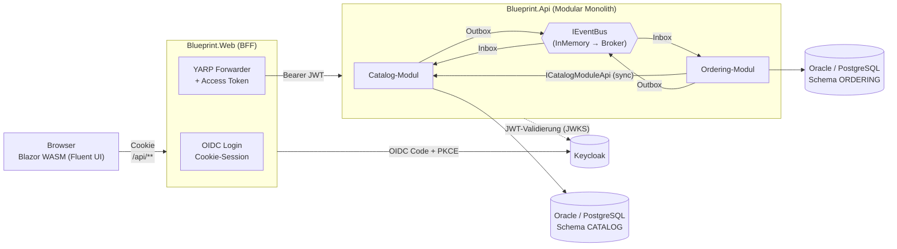

# dotnet-blueprint – Modularer Monolith mit .NET 10

Blueprint für einen **modularen Monolithen** mit **ASP.NET Core Web API**, **Blazor WebAssembly** (Fluent UI Blazor v5)
und einem **Backend for Frontend (BFF)**. Ziel: heute einfach als *eine* Anwendung betreiben, später einzelne Module
mit minimalem Aufwand als **Microservices** auslagern.

| Anforderung | Umsetzung |
|---|---|
| Modularer Monolith, später Microservices | Ein Modul = eigene Projekte (Domain/Application/Infrastructure/Contracts), eigener `DbContext`, eigenes DB-Schema, Kommunikation nur über `*.Contracts`. Grenzen werden durch Architekturtests erzwungen. |
| Gemeinsame Oracle-DB am Anfang | Ein Connection String `blueprintdb`, aber **ein Schema pro Modul** (`CATALOG`, `ORDERING`). Pro Modul kann ein eigener Connection String gesetzt werden. |
| Später PostgreSQL | Provider ist Konfiguration (`Database:Provider`). Migrations existieren für **beide** Provider. |
| Integration Events: erst In-Memory, später Kafka/RabbitMQ/… | `IEventBus`-Abstraktion + **Transactional Outbox** + **Inbox** (Idempotenz). Transport per `Messaging:Transport`. |
| Module/Services müssen Daten voneinander abfragen | Synchrone **Modul-APIs** (`ICatalogModuleApi`) in den Contracts: in-process im Monolith, HTTP-Client (`Blueprint.Modules.Catalog.Client`) nach Auslagerung. |
| .NET 10, Fluent UI Blazor, BFF | Blazor Web App (WASM-Interaktivität) als BFF mit OIDC-Cookie + YARP-Forwarding – Muster aus der Microsoft-Doku. |
| Clients aus OpenAPI mit Refitter | Ein OpenAPI-Dokument pro Modul, beim Build erzeugt (`openapi/`); **Refitter** generiert daraus Refit-Clients + DTOs (`*.Client`). Blazor und Modul-zu-Modul-HTTP nutzen nur diese Clients. |
| Authentifizierung OIDC mit Keycloak | Aspire-Keycloak-Integration: `AddKeycloakOpenIdConnect` im BFF (Code + PKCE), `AddKeycloakJwtBearer` in der API; Realm per Import. |
| Microsoft-Best-Practices | Jede relevante Stelle verweist per `<remarks>` auf die Microsoft-Dokumentation. Keine Fremd-Frameworks für Mediator/Mapping/Validierung. Einzige bewusst gewählte Nicht-Microsoft-Bausteine: Refit/Refitter (gewünscht) und Keycloak. |


## Architektur



### Beispiel-Ablauf (Choreografie-Saga)

1. `POST /api/ordering/orders` – Ordering holt Produktname/Preis **synchron** über `ICatalogModuleApi`.
2. Die Bestellung wird als `Pending` gespeichert; das Domain Event `OrderPlaced` wird in derselben Transaktion als
   Integration Event in die **Outbox** geschrieben → Antwort `202 Accepted`.
3. Der Outbox-Processor veröffentlicht `OrderPlacedIntegrationEvent` über den Event Bus.
4. Catalog reserviert den Bestand (alles-oder-nichts) und antwortet mit `StockReserved` bzw. `StockReservationFailed`.
5. Ordering setzt die Bestellung auf `Confirmed` bzw. `Rejected`. Jeder Handler läuft über die **Inbox** (idempotent).

### Projektstruktur

```
src/
  Aspire/
    Blueprint.AppHost            Lokale Orchestrierung: Oracle|PostgreSQL, Keycloak, API, BFF (+ Dashboard)
    Blueprint.ServiceDefaults    OpenTelemetry, Health Checks, Service Discovery, Resilience
  BuildingBlocks/
    *.Domain                     Entity, AggregateRoot, Domain Events, Result/Error
    *.Contracts                  IntegrationEvent (ohne Abhängigkeiten → NuGet-fähig)
    *.Application                Command/Query/Event-Handler-Abstraktionen, Unit of Work, Outbox-Interface
    *.Infrastructure             ModuleDbContext, Provider-Umschaltung, Outbox/Inbox, Event Bus, Problem Details
  Modules/
    Catalog/  Domain | Application | Infrastructure | Contracts | Client (generiert)
    Ordering/ Domain | Application | Infrastructure | Contracts | Client (generiert)
  Hosts/
    Blueprint.Api                Modulith-Host (setzt die Module zusammen)
    Blueprint.Web                BFF + Blazor-Server-Host (Prerendering)
    Blueprint.Web.Client         Blazor WebAssembly
openapi/                         OpenAPI-Dokumente pro Modul (beim Build erzeugt, eingecheckt)
tests/
  Blueprint.ArchitectureTests    Modulgrenzen & Schichtenregeln
  Blueprint.UnitTests            Domain- und Handler-Tests (MSTest)
docs/                            Vertiefungen (Messaging, Datenbank, Frontend, Auslagerung)
```

**Abhängigkeitsregeln** (geprüft in `tests/Blueprint.ArchitectureTests`):

- `Domain` kennt weder EF Core noch ASP.NET Core.
- `Application` kennt keine Infrastruktur.
- Ein Modul darf von anderen Modulen **nur** `*.Contracts` referenzieren.
- `*.Contracts` hängen nur von `Blueprint.BuildingBlocks.Contracts` ab.
- `*.Client` (generiert) kennen nur `*.Contracts`.
- Der WebAssembly-Client kennt nur die generierten `*.Client`-Projekte.

## Schnellstart

Voraussetzungen: .NET 10 SDK, Docker bzw. Podman (für Aspire), vertrauenswürdiges HTTPS-Entwicklerzertifikat
(`dotnet dev-certs https --trust`, unter Linux siehe [docs/frontend.md](docs/frontend.md#entwicklung-unter-linux)).

```bash
dotnet tool restore
dotnet run --project src/Aspire/Blueprint.AppHost
```

Das Aspire-Dashboard öffnet sich; die Anwendung läuft unter `https://localhost:7201`.
Testbenutzer (Keycloak-Realm `blueprint`, nur für die Entwicklung):

| Benutzer | Passwort | Rollen |
|---|---|---|
| `alice` | `alice` | `catalog-admin` (darf Produkte anlegen) |
| `bob` | `bob` | – |

PostgreSQL statt Oracle:

```bash
dotnet run --project src/Aspire/Blueprint.AppHost -- --Database:Provider=PostgreSql
```

### API direkt testen

`src/Hosts/Blueprint.Api/Blueprint.Api.http` holt per **Client Credentials** ein Token vom lokalen Keycloak
(Client `blueprint-dev`, Service Account mit `catalog-admin`, nur Entwicklung) und ruft damit die API auf.
Die OpenAPI-Dokumente sind in Development unter `/openapi/catalog.json` und `/openapi/ordering.json` erreichbar.

### Tests

```bash
dotnet test dotnet-blueprint.slnx
```

## Konfiguration

| Schlüssel | Standard | Bedeutung |
|---|---|---|
| `Database:Provider` | `Oracle` | `Oracle` oder `PostgreSql` |
| `ConnectionStrings:blueprintdb` | – | Gemeinsamer Connection String aller Module |
| `ConnectionStrings:<modul>` | – | Optional: eigene Datenbank für ein Modul (z. B. `catalog`) |
| `Database:OracleSqlCompatibility` | `DatabaseVersion23` | Oracle-SQL-Dialekt (`DatabaseVersion19`, `…21`, `…23`) |
| `Messaging:Transport` | `InMemory` | Event-Bus-Transport |
| `Messaging:Outbox:*` | 2 s / 50 / 10 | Polling-Intervall, Batchgröße, max. Versuche |
| `Authentication:Keycloak:Realm` | `blueprint` | Keycloak-Realm (API + BFF) |
| `Authentication:Keycloak:Audience` | `blueprint-api` | Erwartete Audience in Access Tokens (API) |
| `Authentication:Keycloak:ClientId` / `ClientSecret` | `blueprint-web` / – | OIDC-Client des BFF (Secret nur via User Secrets/Umgebung) |
| `Services:keycloak:*`, `Services:api:*` | Aspire | Service-Discovery-Adressen (ohne Aspire selbst setzen) |

## Weiterführende Dokumentation

- [docs/messaging.md](docs/messaging.md) – Domain vs. Integration Events, Outbox/Inbox, Broker anbinden (RabbitMQ, Kafka, Azure Service Bus)
- [docs/database.md](docs/database.md) – Schemas pro Modul, Oracle ↔ PostgreSQL, Migrations
- [docs/api-clients.md](docs/api-clients.md) – OpenAPI-Dokumente, Refitter, generierte Refit-Clients
- [docs/frontend.md](docs/frontend.md) – BFF, Authentifizierung mit Keycloak, Fluent UI Blazor
- [docs/microservice-extraction.md](docs/microservice-extraction.md) – Schritt für Schritt ein Modul auslagern

## Microsoft-Referenzen (Auswahl)

- [.NET Microservices: Architecture for Containerized .NET Applications](https://learn.microsoft.com/dotnet/architecture/microservices/)
- [Common web application architectures (Clean Architecture)](https://learn.microsoft.com/dotnet/architecture/modern-web-apps-azure/common-web-application-architectures)
- [Migrate a monolith to microservices (Strangler Fig)](https://learn.microsoft.com/azure/architecture/microservices/migrate-monolith)
- [Secure a Blazor Web App with OIDC and the BFF pattern](https://learn.microsoft.com/aspnet/core/blazor/security/blazor-web-app-with-oidc?pivots=with-yarp-and-aspire)
- [Aspire overview](https://learn.microsoft.com/dotnet/aspire/get-started/aspire-overview)
- [Aspire Keycloak integration](https://learn.microsoft.com/dotnet/aspire/authentication/keycloak-integration)
- [Generate OpenAPI documents (ASP.NET Core)](https://learn.microsoft.com/aspnet/core/fundamentals/openapi/aspnetcore-openapi)
- [EF Core – Migrations with multiple providers](https://learn.microsoft.com/ef/core/managing-schemas/migrations/providers)
- [Transactional Outbox pattern](https://learn.microsoft.com/azure/architecture/databases/guide/transactional-outbox-cosmos)
